# pyckingsolver

**[PackingSolver](https://github.com/fontanf/packingsolver)'s irregular nesting from Python, used like upstream's own `packingsolver.irregular` module, with Shapely polygons welcome.**

[](https://pypi.org/project/pyckingsolver/)
[](https://pypi.org/project/pyckingsolver/)
[](LICENSE)
[](https://github.com/HamzaYslmn/pyckingsolver/actions)

<p align="center">
  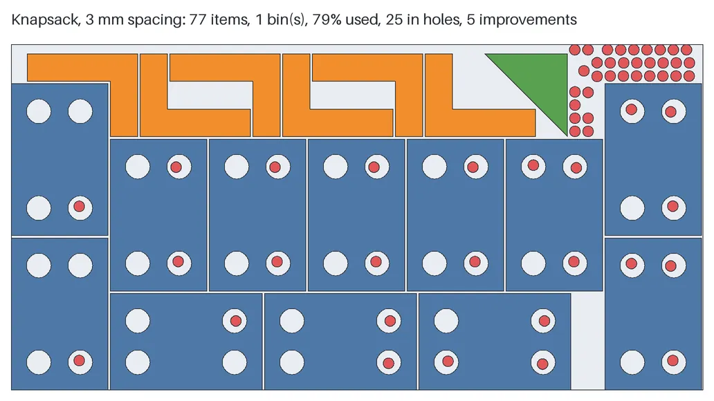
</p>

## Install

```bash
pip install pyckingsolver
```

The wheels bundle the solver binary for Windows x64, Linux x64 and arm64 (glibc 2.39 or newer) and
macOS arm64. Elsewhere, [build it](#building-the-solver) and put `packingsolver_irregular` on `PATH`.

## Quick start

```python
import pyckingsolver as ps
from shapely.geometry import Point, box

plate = box(0, 0, 150, 100).difference(Point(75, 50).buffer(30))  # Shapely: a plate with a hole
ib = ps.InstanceBuilder()
ib.set_objective(ps.Objective.Knapsack)
ib.set_item_item_minimum_spacing(2)
ib.add_bin_type(ps.build_rectangle(500, 300))
ib.add_item_type(plate, copies=6, allowed_rotations=[(0, 0, False), (90, 90, False)])
ib.add_item_type(ps.build_circle(12, ps.Point(12, 12)), copies=40)  # native: one exact arc
instance = ib.build()

p = ps.OptimizeParameters()
p.time_limit = 10
p.stall_timeout = 2  # stop 2 s after the last improvement
p.new_solution_callback = lambda output: print("profit", output.solution.profit())
output = ps.optimize(instance, p)

s = output.solution
for k, item in enumerate(s.bin(0).items):
    placed = ps.to_shapely(s.shape_scaled(0, k))  # the item as placed
    print(item.item_type_id, item.bl_corner.x, item.bl_corner.y, item.angle, item.mirror)
```

A placed item is its shape mirrored about the y axis (when `mirror`), turned `angle` degrees about
the origin, then moved by `bl_corner`; `shape_scaled` returns exactly that.

## Examples

[`examples/example.py`](examples/example.py) runs every scenario below in about 35 s and writes
these images: `cd test && uv run python ../examples/example.py [scenario ...]`.

| | |
|---|---|
|  **laser_sheet**: discs nest in the plates' holes; `new_solution_callback` counts improvements | 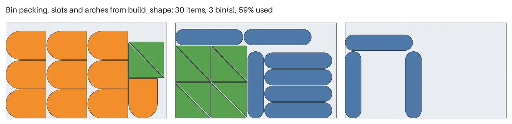 **bin_packing**: arc parts from `build_shape` on as few sheets as possible |
| 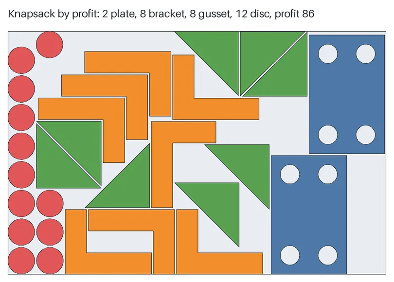 **knapsack**: the sheet is too small, profit decides | 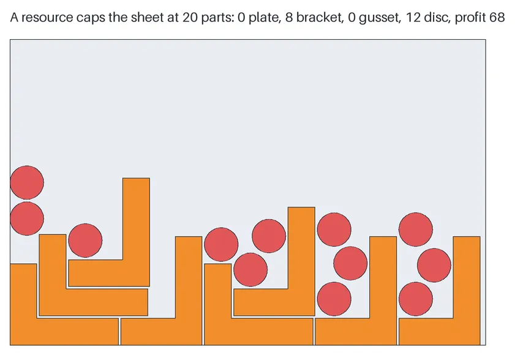 **resource**: a bin resource caps the sheet at 20 parts |
| 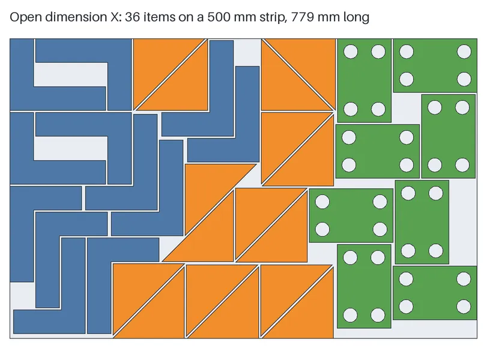 **strip**: `OpenDimensionX`, the used length minimised | 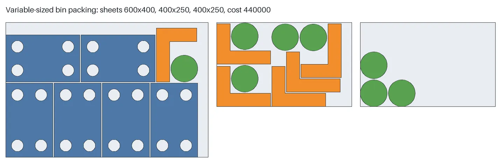 **variable_sized**: three sheet sizes, the cheapest mix |
| 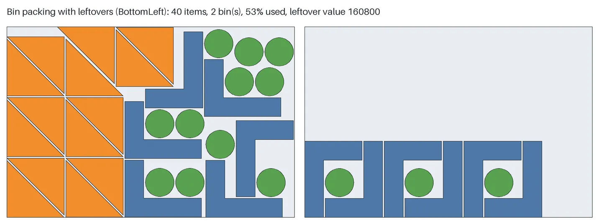 **leftovers**: `BinPackingWithLeftovers`, `LeftoverMode.BottomLeft` | 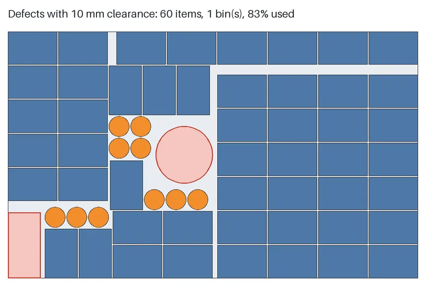 **defects**: two defects kept 10 mm clear |
| 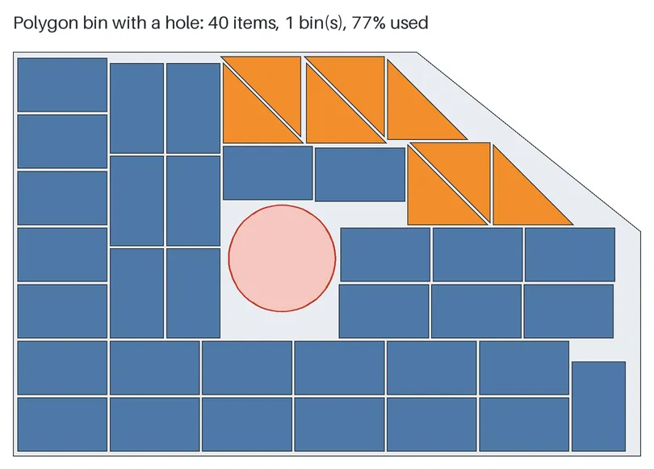 **polygon_bin**: an offcut bin whose hole becomes a defect | 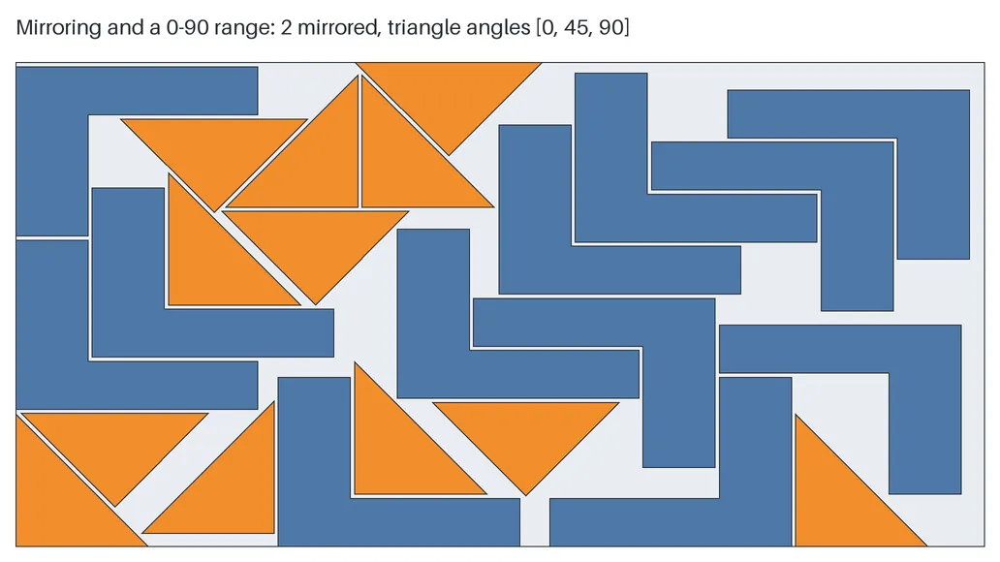 **rotations**: mirrored copies and a continuous 0 to 90 degree range |
| 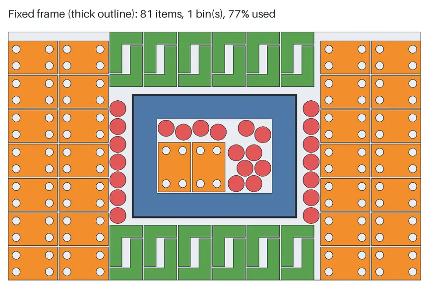 **fixed_item**: a frame fixed before the search, parts around and inside it | |

## API

Names and signatures follow upstream's `packingsolver.irregular`
([bindings](extern/packingsolver/python/src/irregular.cpp)).

**Shapes.** `Point`, `ShapeElement`, `Shape`, `ShapeWithHoles`, `build_line_segment`,
`build_circular_arc`, `build_shape(points)` (`(x, y)` vertices, `(x, y, 1)` / `(x, y, -1)` the centre of
an anticlockwise / clockwise arc to the next vertex), `build_path`, `build_triangle`, `build_rectangle`,
`build_square`, `build_circle`. Every shape argument also takes a Shapely `Polygon` (holes included);
`to_shapely` and `from_shapely` convert.

**`InstanceBuilder`**: ids are the order of the `add_*` calls; `build()` returns an `Instance` and
resets the builder.

| Method | |
|---|---|
| `set_objective(Objective.X)` | `BinPacking`, `BinPackingWithLeftovers`, `OpenDimensionX`, `OpenDimensionY`, `OpenDimensionXY`, `Knapsack`, `VariableSizedBinPacking`, `Feasibility` |
| `set_item_item_minimum_spacing`, `set_open_dimension_xy_aspect_ratio`, `set_leftover_mode`, `set_leftover_all_bins` | instance parameters |
| `add_bin_type(shape, *, cost, item_bin_minimum_spacing, copies, copies_min)` | `cost` defaults to the area, `copies` to 1, -1 is infinite |
| `add_defect(bin_type_id, type, shape)`, `set_item_defect_minimum_spacing(bin_type_id, defect_id, spacing)` | `type` -1 is untyped |
| `add_bin_type_resource(bin_type_id, capacity, penalize, penalty)`, `add_resource_consumption(bin_type_id, resource_id, item_type_id, schedule)` | per-copy consumption |
| `add_item_type(shapes, *, allowed_rotations, profit, copies, copies_min)` | `allowed_rotations`: `(start, end, mirror)` ranges, default `[(0, 0, False)]`; `profit` defaults to the area |
| `add_fixed_item(bin_type_id, item_type_id, (x, y), angle=0, mirror=False)` | a placement fixed in every bin of the type |
| `set_bin_types_infinite_copies`, `set_bin_types_unweighted`, `set_item_types_unweighted`, `set_item_types_continuous_rotations`, `read(path)` | |

**`OptimizeParameters`**: upstream's fields as far as the binary's command line reaches them
(`time_limit`, `verbosity_level`, `optimization_mode`, `use_tree_search` and the other `use_*`
algorithm switches, queue sizes, `reduction_parameters.reduce`, ...), plus:

- `new_solution_callback(output)`: called with an `Output` on each new best solution.
- `stall_timeout`: stop once no new solution came for this many seconds.
- `first_solution_timeout`: stop if no solution came at all by then.
- `cancel`: anything with `.is_set()`; once set the binary is killed and `OptimizeCancelled` raised.

**`optimize(instance, parameters) -> Output`**: `output.solution`, `output.time`, the bounds
(`knapsack_bound`, `bin_packing_bound`, ...), `is_proven_infeasible`, `is_proven_optimal()`. A solve
that found nothing returns an empty solution; a rejected instance or a crash raises `RuntimeError`.

**`Solution`**: `bins`, `bin(i)` (`bin_type_id`, `copies`, `items`), `number_of_bins()`,
`number_of_items()`, `item_copies(t)`, `shape_scaled(bin_pos, item_pos)`, the metrics (`profit()`,
`cost()`, `x_max()`, `full_waste_percentage()`, `leftover_value_orig()`, ...), `to_json()`,
`write(path)`. **`SolutionItem`**: `item_type_id`, `bl_corner.x`/`.y`, `angle`, `mirror`, `is_fixed`.

## Differences from packingsolver's own module

- Shapes are pure Python; a Shapely polygon goes wherever a shape does. `build_circle` takes an
  optional centre.
- `optimize` runs the bundled `packingsolver_irregular` binary in a subprocess (crash isolation, a
  hard kill) and reads each new solution back from its certificate; hence `stall_timeout`,
  `first_solution_timeout` and `cancel`.
- A bin's holes are sent as defects (upstream reads a bin without holes).
- `add_fixed_item` is upstream's C++ builder method, absent from its Python bindings.
- Command-line knobs the bindings lack: `seed`, `group_identical_bins`, `anchor`, `anchor_x_weight`,
  `anchor_y_weight`, `post_process_last_bin_maximum_number_of_items`,
  `anytime_sequential_value_correction_growing_queue_maximum_number_of_iterations`.
- Not reachable through the command line, so absent: `many_items_in_bins_threshold`,
  `many_item_type_copies_factor`, `periodic_packing_copies_threshold`,
  `periodic_packing_max_items_threshold`, `tree_search_guides`, the reduction switches other than
  `reduce`, the messages and solution-pool settings.
- Defaults that differ: `linear_programming_solver_name` is `Highs` (the binary is built without CLP),
  and reduction is off when a bin has fixed items (upstream's reduction then throws).
- The binary is built without Knitro and SCIP, so the algorithms that need them are unavailable.

## Known solver limits

Measured on the bundled binary:

- **A fixed item's holes can stay empty**: the shape simplification shrinks them below every
  candidate item, and the first beam search then stops (details in [AGENTS.md](AGENTS.md)).
- **A knapsack can settle on a wasteful arrangement**: tree search packs along a skyline, so a gap
  closed by two later parts is never refilled.
- **A resource on one item type leaves free space unused**: in the `knapsack` scenario, capping the
  discs at 4 with a resource gives profit 48; `copies=4` instead gives 64. A resource every item type
  consumes (the `resource` scenario) behaves.

## What's new in 0.11.3

C++ pin `f9c90a7a`: certificates now mark fixed items (`fixed_item_pos`), and `is_fixed` reads that
mark. Placements and API unchanged.
History in [CHANGELOG.md](CHANGELOG.md).

## Building the solver

As [`build.yml`](.github/workflows/build.yml) does it (Linux needs `ninja-build liblapack-dev
libbz2-dev`; on Windows run from an MSVC developer shell):

```bash
git clone --recurse-submodules https://github.com/HamzaYslmn/pyckingsolver.git
cd pyckingsolver/extern/packingsolver
cmake -S . -B build -G Ninja -DCMAKE_BUILD_TYPE=Release -DPACKINGSOLVER_BUILD_TEST=OFF -DPACKINGSOLVER_USE_CLP=OFF
cmake --build build --target PackingSolver_irregular_main --parallel
cp build/src/irregular/packingsolver_irregular ../../python/pyckingsolver/bin/   # .exe on Windows
```

Checks: `cd test && uv run python test_pyckingsolver.py`.

## License

AGPL-3.0-or-later, see [LICENSE](LICENSE).

Based on [PackingSolver](https://github.com/fontanf/packingsolver) by Florian Fontan, which is MIT
licensed. The wheels bundle a compiled `packingsolver_irregular`, so upstream's notice ships with
them as `LICENSE.packingsolver`.

The binary is built with `-DPACKINGSOLVER_USE_CLP=OFF`. That flag is load bearing: Clp, CoinUtils
and Osi are EPL-2.0, which does not combine with the AGPL. HiGHS (the solver actually used), Boost,
nlohmann/json and every fontanf dependency are MIT or BSL-1.0 and combine fine.
